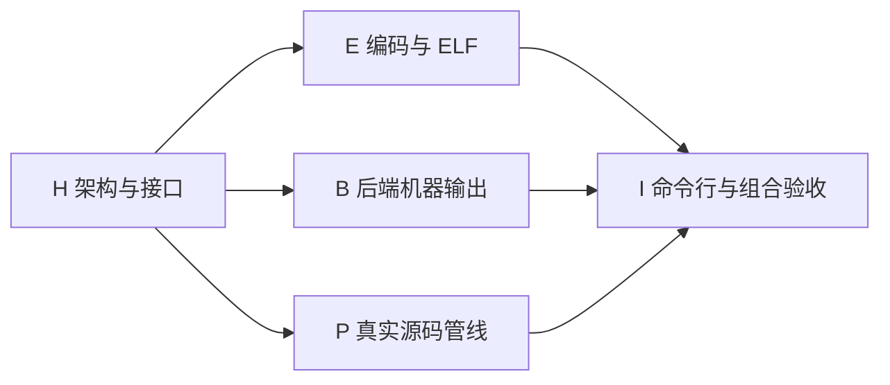

# B0/B1 原型交付 DAG

执行 [dag-delivery](</home/mii/.codex/skills/dag-delivery/SKILL.md>)；用户明确确认使用 subagents。共享工作区，写入范围互斥；主代理维护接口、源码管线和集成，独立验收者没有修改实现。

| 节点 | 实施者 | 独立验收者 | 当前候选 | 状态 |
| --- | --- | --- | --- | --- |
| H | `/root` | `/root/acceptance` | r2 | 已验收 |
| E | `/root/encoder` | `/root/acceptance` | r1 | 已验收 |
| B | `/root/backend` | `/root/acceptance` | r1 | 已验收 |
| P | `/root` | `/root/acceptance` | r1 | 已验收 |
| I | `/root` | `/root/acceptance` | r1 | 已验收 |

H r1 因缺少 pipeline 模块导出被拒绝，修订为 r2 后通过；原判定保留。E/B/P 在 H r2 通过后实施，I 在 E/B/P 全部通过后实施。机器层和源码层测试均实际执行，没有用作者完成消息代替独立验收。

记录入口：[workflow.json](workflow.json)。每个候选包含文件 SHA-256 和依赖版本，每个 review 包含实际验收者、判定、验证和范围。工作流日志本身可更新；受验源码、设计合同、用户 README 和冻结证据的变化须产生新候选及影响复核。

- [架构合同](../../design/bootstrap-prototype.md)
- [使用与范围](../../../core-s/README.md)
- [规模账本](metrics-r1.json)
- [最终清洁构建记录](I-clean-build-r2.json)

本次产物仍为宿主 Rust 原型和既有 Core S 子集，不是 R1a、操作系统或自编译完成声明。最终交付状态以当前候选对应的独立 I 判定为准。

最终 I r1 [独立判定](I-r1-review.json)通过，全部最新候选已验收。独立探针源码和复现方式保存于 [probes](probes/README.md)，其原始路径及摘要对应关系见 [archive-map.json](probes/archive-map.json)。
