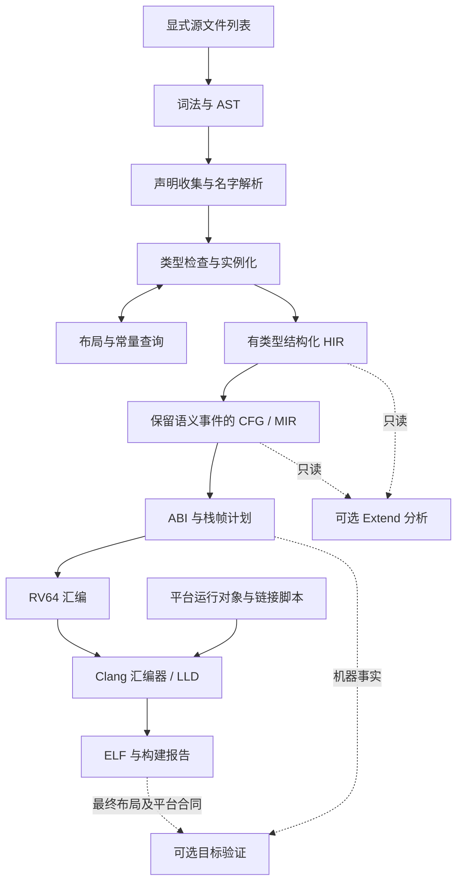

# Rust Core 编译器架构设计

本文件记录首版的实现结构与设计约束；验收状态见 [core-delivery](core-delivery.md) 和实际运行报告。本设计遵守 [reference 0.5](reference.md) 与 [rv64-core-v1](architecture-rv64.md)，不添加源语言能力。后端采用用户确认的直接 RV64 汇编路线；Extend 按进程内接口实施，本轮不提供稳定外部文件协议。

## 1. 编译流水线与边界



流水线只设三种程序表示：AST 保存源结构；HIR 保存已解析、已定型的表达式和词法结构；MIR 保存显式求值顺序及控制流。机器计划是 ABI／栈槽／指令选择数据，不再建立通用优化 IR。先用确定性、串行的完整构建，不加入增量查询框架、SSA 优化器或全局寄存器分配器。

语义检查覆盖范围与代码发射范围分离：所有非泛型函数、所有要求检查的具体类型和函数实例都检查；不能因函数未导出、未调用或语句不可达而跳过错误。发射可从导出、平台入口和实际引用形成闭包，删除代码只发生在完成所需检查之后。

目标代码生成只依赖 Core 语义。启用 Extend 可以阻止构建成功，不可改变布局、ABI、求值顺序或赋予 `&mut` 无别名假设。即使关闭验证，结构性 Copy／resource／携带引用分类仍按 Core 要求计算。

## 2. 工程组织

首版使用一个 Rust package，包含可复用 library 与薄 CLI binary；测试驱动直接调用 library 或 CLI。工程使用以下模块边界：

| 模块 | 职责与主要输出 |
| --- | --- |
| `source`、`diagnostic` | 文件、UTF-8 字节位置、规范错误类别与相关位置 |
| `syntax` | 固定 Unicode 15.1 词法、递归下降声明／类型解析、Pratt 表达式解析、AST |
| `resolve` | 模块合并、声明身份、导入／可见性、名字绑定、内建声明注册 |
| `types`、`check` | 类型驻留、表达式局部推导、位置／unsafe 检查、方法与适配、HIR |
| `check` 的实例缓存、`check::patterns` | 泛型检查工作表及依赖图；不可反驳性与穷尽性矩阵 |
| `layout`、`check::constants` | 目标布局、类型参数布局依赖、常量与符号重定位、循环诊断 |
| `ir`、`lower` | HIR／MIR 数据、位置与操作数、完整表达式、作用域退出展开 |
| `abi`、`target::rv64`、`linkage` | ABI 分类、栈帧计划、算术／内存／原子／汇编降低、文本发射与 ELF 名字字节恢复 |
| `extend` | 只读视图、分析注册与依赖、结果和事实表；本轮无实际验证器 |
| `driver`、`toolchain` | CLI、构建请求、外部进程、链接、依赖与复现报告 |

陷阱汇编与运行支持放在 `runtime/rv64/`，启动汇编、链接脚本与平台配置放 `platforms/qemu-virt/`；测试分为现有 `tests/conformance/`、接口／语义测试、`tests/integration/` 和运行夹具。生成的 Unicode 表单列来源及生成步骤，不混入手写代码统计。

模块用 `FileId`、`DefId`、`TyId`、`LocalId`、`SlotId` 等带类型的索引引用表；泛型实例以声明身份与类型实参为键。ID 仅在一次编译中有效，遍历／发射排序明确。布局、内建分类与 ABI 决策只有一个权威实现，其他阶段通过查询复用。

## 3. 前端与静态查询

先解析所有输入，再收集模块和声明，之后解析签名／主体名字，使前向引用与源文件顺序无关。名字解析区分用户声明与 `Symbol::Builtin` 的规范路径；`addr_of` 的特殊位置语义由解析结果选择，不按未经解析的源字符串识别。`arch::asm` 和布局语法内部函数按规范的专用语法解析。

推导作用域限定在一个完整表达式／初始化器；先传播期待类型与结构等式约束，再默认尚未约束的整数字面量。隐式适配成为显式 HIR 节点，包括可变引用再借用、只读切片视图和函数指针适配。后续语句不能反向补全先前绑定类型。模式在保留类型结构时完成检查，之后再降低标签／字段分支。

语义类型保存函数效果、ABI、unsafe、地址空间和完整实参。`core_compatible` 按规范忽略效果的接受限制，但不能擦掉语义类型中的效果；适配记录源、目标签名，包含嵌套函数指针及聚合组件。机器表示类型另算，不能让机器层的“相同大小”充当源类型身份。相同基础类型但效果不同的表达式合并，也保留各输入与结果的对应关系供后续分析。

泛型保留已解析模板及其源信息，实例按声明与完整实参缓存；活动实例栈与依赖图记录正在检查的实例，失败通过诊断返回。同一实例递归可复用签名并记录依赖边，禁止因命中缓存跳过多态递归检查：实例依赖图中必须检查路径上的同一声明是否以不同实参重现。未使用模板仍检查名字和语法；依赖类型的约束在实例上检查。

布局首先执行 reference 10.3 的类型参数依赖不动点及声明图环检查，再计算具体实例的偏移、大小和对齐。不能用“名义声明再次出现在递归栈”拒绝有限的 `Wrap<Wrap<u32>>`。常量、延迟表达式和布局各自记录活动查询，配合声明依赖图拒绝循环。缓存属于一次固定 RV64 目标的编译会话，不跨目标或编译复用。

泛型数组长度保存原 AST、定义模块与类型参数绑定。依赖表达式由 `ConstExprId` 和完整具体实参索引，实例化后经普通类型与常量检查求值，已检查长度存入 `TypeContext`；类型替换、布局、降低和 Extend 读取同一结果。未求值的查询保留显式状态，不能用零长度占位。声明布局依赖单独保留所有分支中的查询，缓存命中不能删除循环检查所需的边。

常量用目标位宽的整数与结构值表示，静态地址表示为 `Symbol + Addend`；序列化结果为字节与重定位列表；未初始化包装器的源语义保留在 HIR 和类型中。宿主地址不进入目标值。常量表达式先完成允许操作检查（包括死分支），再只执行被选择的分支；常量与运行时共享算术规则描述，但编译期失败与运行时 panic 分开报告。布局大小计算的溢出不借助宿主 `usize` 自然截断。

## 4. 语义 IR 与 cleanup

HIR 保留结构化控制流、模式、词法 `ScopeId`、defer 注册点、unsafe 区域和实例来源。降低时根据这些结构生成 MIR 的 `FullExpression` 进入／退出事件。MIR 使用非 SSA 的局部／临时槽和基本块，顺序明确、可读可打印。

```text
Place   = Slot/Global/Pointer + byte offset + TyId + alignment
Operand = Slot | Integer | Symbol + addend
Event   = StorageLive/Dead | Inspect | Copy | Move | Borrow | RawAddress
        | ReborrowView | Conversion | Defer | FullExpression | SplitSlice | Unsafe
Instruction = Set | Store | Copy | Zero | Call | Intrinsic | Asm | Event
Terminator  = Goto | Branch | Switch | Return | Panic | SpecialTransfer | Unreachable
```

以上对应 `src/ir.rs` 的结构，完整字段以 Rust API 为准。指令保存源码位置，位置和操作数携带类型信息，存储槽关联词法作用域；原始字段／下标／变体投影结构可从同时保留的 HIR 读取。动态下标在 MIR 中先求值再计算地址，不能在每次访问时重新求值。间接位置保留“经哪个值解引用”，Core 不替 Borrow 算别名根或来源集合。

Move 是语义事件，不要求运行时清零或移动标志。字段赋值记录覆盖和新值写入，不因未读取旧值而插入旧值加载。借用、原始取址、复制切片描述符和读取元素是不同操作；`split_at_mut` 保留专用身份和输入／输出关系，分区证明留给 Borrow。

统一 `exit_scopes(destination, saved_value)` 生成正常退出清理：块尾、return、`?` 的错误分支、break、continue、特殊陷阱转移都经此处。先保存要转移的值／帧地址，再从内到外处理每个退出作用域：执行该作用域已注册的 LIFO defer，然后结束其剩余局部存储；临时存储另按完整表达式边界处理。panic 和不返回路径不执行剩余 defer。defer 内的名字在注册点绑定，值在执行时读取；不是捕获注册时的值快照。

降低结构化控制流时维护每条路径已经注册的 defer 序列；不同路径不能凭空执行未注册动作。首版在出口生成清理块，以 `SemanticEvent::Defer.source` 保留共同源编号与每次执行节点的关系；不使用运行时 defer 栈或 GC。临时对象延长到 match／for 结构结束等规则在 HIR 到 MIR 时落实。HIR 保留语法上不可达的检查信息，MIR 标记真实控制流边，扩展不因 cleanup 克隆丢失源身份。

调用表达式先保存 callee，再依次求实参；每个聚合实参在其求值点建立快照。赋值先保存 RHS，再求 LHS 位置；复合赋值随后加载当前位置值。这些规则在 MIR 中表达完毕，后端不得重新安排。清理前保存返回值也适用聚合及携带引用的结果，保存引用不会延长其目标存储期。

## 5. RV64 后端

后端分成“共享布局查询 → 调用计划 → 栈帧计划 → 指令发射”。首版为需要保存的局部和临时分配栈槽，仅用少量临时寄存器计算；不追求优化，不依赖 C 后端、LLVM IR 或 libc。可以生成短循环处理大聚合复制，避免展开巨大数组导致代码膨胀；复制可能重叠时按该操作合同处理，不能一律假定 memcpy 的非重叠条件。

普通 biomiya ABI 与 C ABI 使用独立分类入口，共享物理参数位置结构 `ArgLoc`／`ReturnLoc`。普通 ABI 对非零聚合使用快照地址、聚合返回使用首位隐藏结果指针；C ABI 按固定 psABI 实现标量扩展、聚合拆分、寄存器耗尽及栈边界、间接返回。函数指针使用同一分类。省略零大小机器参数仍保留其求值、移动和存储事件。

栈槽记录大小与实际所需对齐，所有调用点保证 16 字节栈对齐。支持局部 4096 对齐时动态向下对齐栈，并保存入口 SP／稳定帧基址以恢复；传入栈参数仍相对原入口定位。机器事实报告固定区、实参区和最大重新对齐余量，不能把“帧大小”误报为只含局部变量。大偏移、长分支及不可编码立即数有明确展开，不假定都落在 12 位立即数范围。

后端为所有内存访问带上已知对齐与访问种类：packed 普通读写可拆为字节操作；volatile／MMIO 则使用规定宽度的一次访问。零大小对象使用非空、满足对齐的地址表示，逻辑身份由 IR 保留；不能由相同数值地址推导为同一对象。聚合相等按字段／活跃载荷递归，不能比较未规定的填充字节。

所有整数位宽均显式处理截断／扩展、溢出、除零、MIN/-1、移位计数及有符号索引。失败边在危险机器操作前分支到 panic。常量消息放只读静态存储，显式 panic 传运行时消息切片。后端若生成辅助调用，必须将符号及其上下文合同登记为构建依赖；首版优先内联复制／清零循环，避免隐式引入宿主工具链运行库。

原子顺序合法性由前端检查，MIR 保存源请求顺序；首版允许统一提升到 SeqCst，但每种操作仍须对应目标补充固定的原子映射，不以“加 aqrl”代替完整映射审查。窄原子只操作独占的 32 位槽并保持高位为零。LR/SC 强 CAS 对保留集失败重试，对值不相等才返回 Err；重试段须满足 ISA 对 LR/SC 序列的要求，不含调用、分配或睡眠锁。

内联汇编先保存全部输入，再保存全部输出位置；入口装载固定寄存器，出口先保存所有输出寄存器，再进行输出写回，避免写回一个输出时破坏另一个输出寄存器。未列出的寄存器按平台合同，普通内存按屏障处理；编译器的暂存地址不能依赖允许被汇编破坏的寄存器。asm、CSR、设备 fence 保留源顺序及效果说明。

初版关闭汇编与链接 relaxation，使用明确 ISA／ABI 参数；修饰名确定且唯一。汇编器负责机器编码，链接器负责最终重定位；编译器仍负责选择可用的寻址序列，遇到不可表示的最终链接范围必须失败而非错误截断。调试以源位置注释、IR、汇编和链接 map 为先，完整 DWARF 不作为首版交付前提。

## 6. 平台、运行时与测试驱动

参考平台为 `qemu-virt-core-v1`，与语言目标分离。QEMU `virt` 提供多 hart、UART、CLINT／PLIC 和测试设备，且通过设备树描述设备；平台配置固定 QEMU 版本与机器参数，设备地址必须由设备树或经过核对的配置取得。[QEMU virt 文档](https://www.qemu.org/docs/master/system/riscv/virt.html)

首版工程默认使用随仓库维护的最小 M-mode 启动桩进入 S-mode，避免依赖未锁定的默认固件；该桩不是 Core 源程序。它负责 hart 身份、PMP／中断委派、初始内存与栈、gp／tp、二级 hart 启动同步，以及进入平台入口。M0 用真实 QEMU 启动验证这一路线，随后固定参数与内存图。语言生成代码按 rv64-core-v1 运行，不因测试机器额外支持其他指令就使用它们。

运行时职责分离为启动、trap 汇编入口／返回、`__biomiya_dispatch`、`__biomiya_panic`、测试报告适配器；不隐式启用 Extend。链接脚本明确代码、只读、可写及零初始化区、入口、栈和边界符号，并检查 section 权限及对齐。平台负责链接所需依赖，编译器不推断一个名字叫 `.rodata` 的自定义节必然可写或只读。

trap 入口按目标定义保存完整整数状态及 288 字节 TrapFrame，先安全建立每 hart 状态再调用语言入口。首版选择“检测到嵌套故障可靠 panic”的允许策略；使用独立的每 hart 紧急状态／栈，不能覆盖活动帧，也不能借普通日志锁造成递归故障。保留以后支持嵌套帧的内部空间，不更改源 ABI。正常 handler 返回与 entry 特殊转移的 defer 都由编译器先完成，运行时再恢复状态并 SRET。

测试适配器由编译器身份系统定位 `test` 并生成普通 biomiya ABI 调用，不猜私有修饰名，也不把它当 C 函数。报告协议按测试 ID 区分正常返回值、panic 和平台故障，主机超时归基础设施失败。独立 C 夹具只用于 C ABI 互操作校验，不承担语言实现。[Clang 交叉编译配置](https://clang.llvm.org/docs/CrossCompilation.html)中的目标与 ABI 参数必须由驱动显式提供，宿主默认值不能进入目标构建。

多 hart 夹具在启动同步后执行原子场景；MMIO 用真实设备和 QEMU 内存访问 trace 核对地址、次数和宽度，配合执行指令轨迹检查设备 fence。M0 确认选用设备允许的访问宽度与 trace 粒度；若无法覆盖，补充可复现的测试设备夹具，不把该项目改成 RAM 测试。陷阱夹具主动触发同步异常及可恢复 IRQ，核对 x1—x31、sepc／sstatus、defer 顺序与嵌套故障策略。

## 7. Extend 接口合同

本节按进程内 Rust 接口设计；接口与编译器同版本构建，不承诺 Rust 动态库 ABI。首版交付只读视图、调度和协议测试，不注册伪造的 Ownership／Borrow／Blocking 实现。若用户选择外部 IR 协议，还需增加 schema、跨进程身份与版本兼容策略；不能仅把调试打印改成 JSON 就称完成。

```text
ExtensionDescriptor { name, version, dependencies, supported_target, phases }
SemanticView { declarations, templates, types, instances, hir, mir, source_map }
TargetView { abi_plans, machine_facts, linked_image, platform_contracts }
AnalysisReport { analysis, version, scope, status, diagnostics, assumptions, facts }
status = NotEnabled | Verified | Violation | Unknown
```

两个观察阶段：语义阶段在 Core 检查完成、MIR cleanup 展开后读取 HIR／MIR；目标阶段读取机器计划、最终 ELF 和平台事实。Kernel 的栈或驻留分析不能仅凭源 CFG 声称成功。`check` 没有最终目标事实时，需要这些事实的已请求验证报告 Unknown；不补造栈界限。

| 信息 | 为什么必须保留 | Core 不提前计算的部分 |
| --- | --- | --- |
| 位置投影、Copy／Move、覆盖、存储开始／结束、resource | Ownership 的使用、分支与消费检查 | 各路径拥有状态与资源证明 |
| 原始借用／再借用、完整表达式、词法边界、调用参数和结果关联 | Borrow 的区域、返回来源和逃逸检查 | 来源集合、别名冲突、借用状态 |
| 切片拆分身份、输入／输出、零大小逻辑索引 | Borrow 的分区特例 | 动态分区关系及合并证明 |
| defer 注册点、绑定身份、执行克隆、真实 cleanup 顺序 | 检查未来使用及退出顺序 | 提前结束借用等分析决定 |
| 全部函数效果、间接调用类型、适配两端、外部声明、asm effects | Blocking 防止效果经转换或重声明丢失 | 调用图上的效果传播与合同验证 |
| 原子原始顺序、实际映射、地址空间、volatile／MMIO、unsafe 位置 | Concurrency 区分普通访问、同步与受信操作 | 共享、发布、跨上下文协议证明 |
| 栈帧上界分项、机器调用边、clobber、运行依赖、链接区间 | Kernel 分析栈、递归、驻留与故障闭包 | 间接目标求解、平台可靠性证明 |

分析以只读句柄取信息，输出独立事实表及诊断，禁止改写 Core IR。事实表以编译会话与语义 ID 为键，有来源分析／版本；依赖分析读取其规定的结果，不能把空表当通过。对象和模块的验证范围、外部受信合同、未解析间接调用、平台假设必须进入报告，不能仅存一个全局布尔值。

驱动在解析源代码前验证扩展配置和依赖；专用属性仅由已启用且支持对应补充规范的扩展注册，未识别属性仍是 Core 错误。已知但未实现的分析请求报不可用，不伪装为 NotEnabled 后继续成功；NotEnabled 用于未请求的分析。严格构建只有所有请求性质 Verified 才成功，Violation 与 Unknown 分别诊断，失败不能发布为通过验证的 ELF。

首版不缓存验证结果。以后缓存键必须覆盖源与依赖内容、Core／扩展版本、目标／代码生成设置、运行对象、链接脚本和平台／外部受信合同；其中任一变化就失效。进程内 ID 不能直接跨构建复用。

接口验收使用明确标成测试专用的读取探针：检查 defer 晚读取、隐式再借用、效果嵌套转换、原始取址无 Move、切片分区事件、泛型源映射及机器帧信息是否齐全。另用假分析结果测试四态、依赖错误和严格构建门禁。它们只验收接口，不在用户报告中记作实际语义验证通过。

## 8. 风险与实现准则

| 风险 | 设计措施与最迟验证阶段 |
| --- | --- |
| 泛型／布局互递归或缓存改变结果 | 显式依赖图、查询状态、输入／检查顺序置换；M2 |
| 前端把 Core 接受与 Extend 限制混在一起 | 分类接口分离，现有 9 个 Extend 用例做 Core 接受检查；M2 |
| defer 与实参／返回聚合快照出错 | 一个退出展开入口、显式临时、改变源值的顺序例；M1 起，M3 完成 |
| C ABI、栈高对齐或汇编破坏暂存 | 独立调用计划；与 C 双向验证；大帧／4096 对齐／多输出例；M3—M4 |
| 原子“看似可跑”却不符合模型 | 固定映射依据、机器序列审查、多 hart 场景；M4 |
| 平台结果掩盖编译器失败 | PASS／PANIC／平台故障分离，实际 ELF 执行及设备轨迹；M0 起 |
| 为扩展提前实现大量分析 | 只保留语义与源结构；探针验证信息可达；随各阶段验收 |

实现优先使用小而直接的数据结构和函数，公共查询少而明确。已有内建集合按声明身份统一注册，不通过越来越长的名字特判散落在解析器和后端。测试选择具有区分力的语义反例和真实互操作，不以大量复制实现逻辑的单元测试代替目标验证。

工程按这些边界实施；当前证据和剩余事项以 core-coverage.json 及完整验收报告为准。设计说明本身不构成合规范通过声明。
