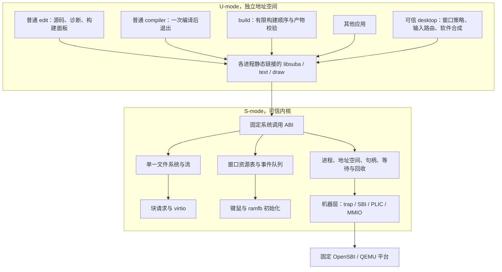
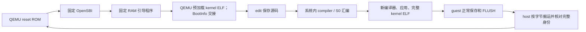

# suba 全局架构

2026-10-14，设计版本 0.2。需求以 [REQUIREMENTS](../REQUIREMENTS.md) 为准；K0 已验收，完整系统尚未实现。本次范围变化见 [SCOPE_REVISION](SCOPE_REVISION.md)。历史调查输入为 [平台 A r2](research/platform.md) 与 [工具链 B r1](research/toolchain.md)。具体接口见 [CONTRACTS](CONTRACTS.md)，依赖和验收见 [IMPLEMENTATION](IMPLEMENTATION.md)。

## 1. 总体取舍

采用**小型模块化宏内核、受保护的单线程进程、独立可信桌面进程、普通编辑器和编译器进程**。文件系统与设备驱动放在内核；窗口策略和绘制放在用户态。系统只有一种资源归属规则、一种等待规则、一条进程结束路径。

Oberon 的启发落实为共同设计源码、语言、系统接口和交互环境。现代保护边界则由 S/U 特权级和 Sv39 页表承担。普通应用的 unsafe、panic、死循环不能获得内核权限。语言本身不承担尚不存在的内存安全证明。

首版固定：QEMU virt、RV64、TCG、单核、512 MiB RAM、256 MiB raw 磁盘、1024×768 软件桌面。采用 OpenSBI、PLIC、SBI TIME/SRST、virtio-mmio block/keyboard/tablet、ramfb。实际宿主支持及探针见平台调查；这组完整系统容量尚未实测。

选择直接调用和少量具体枚举分派；不引入通用 IPC 总线、服务注册框架、VFS、插件驱动、对象继承或 async 语言运行时。每个新增机制必须解决当前闭环中的具体问题。首版不做线程、fork、信号、动态链接、分页换出、网络、Linux/POSIX 兼容、多核、GPU 加速和复杂排版。

## 2. 部署与信任图

图中的 `libsuba` 是按需静态链接的源模块，不是共享地址空间或常驻服务。desktop 只获得必要的显示、输入、窗口管理和终止应用权限；没有原始块写或任意物理内存权限。电源管理权限由内核初始授予专用管理入口，不能靠 ELF 路径名、进程名或父进程随意指定获得。内核槽发布权限和接口保留延期，首版不授予该能力。

内核/驱动错误允许 panic；desktop 是明确列入可信计算基础的系统程序，其崩溃或内部不变量损坏也停止系统，不实现透明重启。edit、compiler 和一般 build 工作不属于可信计算基础。普通产物发布仅经文件接口；将来恢复内核槽发布时，其格式与目标必须由内核验证，工具错误不能绕过槽边界。可信组件变少是实现方向，不能将未经验证的应用输入称为“可信”来跳过检查。

所有普通程序处在单用户工作区，默认可通过文件接口修改该工作区；这是共享文件权限，不等于可破坏其他进程的私有内存。首版不承诺阻止获得写权限的程序删改共享文件。句柄拥有独立类型与权限，原始设备、启动区和桌面管理权仍隔离。

## 3. 内核执行模型

每个进程一个用户执行流。用户态由定时器抢占，初始时间片 5 ms、普通进程轮转；desktop 为普通可抢占任务，允许交互唤醒时进入下一轮队首，但每轮每进程至多一片，不能永久饿死编译器。

内核不在任意函数栈深度切换进程。trap 保存用户全部现场，进入一个共享内核栈；系统调用处理器要么完成，要么把继续执行所需的小型状态存入 `Request` 并返回调度循环。没有每进程睡眠中的内核调用栈，也没有隐含 await。内核 `step` 在有界工作量后结束；磁盘中断只确认完成、登记事件，后续动作由循环推进。

第一版 S-mode 处理期间关闭 S 中断；每轮内核工作有字节/条目上限，然后重新检查挂起中断并回用户态或开中断进入 idle。M-mode 固件中断不等于 S 中断重入。禁止运行期轮询等待设备；超过设备超时属于平台故障并 panic。早期引导无进程时可以有超时的轮询。此选择省掉锁体系，但要求真实验证最长关中断时间，不能把“单核”当作延迟证明。

一个 trap 最多推进固定数量工作片；大型 BSS 清零、ELF 装载、目录扫描、文件删除、图像复制全部可以分片。硬中断、请求推进和调度由 `kernel::dispatch` 串联。叶模块返回 `Done / More / Wait / Failed` 等具体结果，不能反过来调用调度器或直接唤醒任意进程。Blocking 分析可检查部分外部合同，不证明循环终止或实时性。

## 4. 模块边界与状态所有者

| 模块 | 独占状态 | 接口责任 | 禁止承担的职责 |
|---|---|---|---|
| `machine` / `platform` | trap 入口、设备地址与中断配置 | 保存现场、CSR/SBI、明确宽度 MMIO/fence、有界 FDT 读取 | 文件、窗口、用户策略 |
| `memory` / `space` | 物理页账本、各地址空间映射 | 分配/清零/回收、权限、逐页 usercopy | 解释文件和用户指针指向的业务对象 |
| `process` | 进程表、就绪队列、退出记录、配额 | 创建事务、调度状态、统一终止 | 私自释放设备仍持有的页 |
| `objects` / `request` | 类型句柄、引用、代数、等待登记 | 权限校验、请求令牌、关闭/取消/完成 | 万能资源框架或用户可定义对象类型 |
| `virtio` / `block` / `input` | 队列、DMA 缓冲、在途请求 | 提交/完成、FLUSH、键鼠事件 | 直接访问用户地址或保存用户裸指针 |
| `fs` / `stream` | 名字、节点、块链、缓存；流环缓冲 | 文件及构建输出、持久化、EOF/背压 | 窗口策略、任意插件协议 |
| `window` | 窗口身份、owner、表面页、事件、已提交位置/焦点 | 限额、像素拷贝、生命周期、管理权限 | 字体、控件、拖动算法、编辑器 |
| `dispatch` | 一个有限的顶层推进顺序 | 组合以上动作，交付完成，调度 | 重复维护各模块的内部状态 |
| `desktop` | 叠放策略、拖动状态、合成缓冲、损伤集合 | 可信用户态窗口管理和软件绘制 | 进程页表、磁盘布局、编译器内部状态 |
| `edit` / `build` | 文本缓冲、选区、构建作业 | 编辑、保存、诊断定位、有限顺序构建 | 自己实现进程回收或通过宿主编译 |

模块依赖从编解码/检查函数向上到资源所有者，最后到 dispatch。下层通过返回值报告事实，不调用上层；S-next 的 import 无环约束应在清单中直接体现。共享记录只存身份和快照，不能公开可任意写入的全局数组。确需多模块修改的记录应收回唯一所有者并提供少量语义操作。

适量采用函数式架构风格：范围检查、ELF/FDT/磁盘编解码、路径解析、UTF-8 边界、裁剪与布局是给定输入产生结果的函数；分配、I/O、窗口更新由明确所有者执行。状态机转换与产生的动作可单测。不要为“纯”而复制 55 MB 编译器状态、页表或整个文件系统，也不引入通用 effect/interpreter 框架。

## 5. 首版启动、原生构建与宿主部署

固定启动基础为 QEMU/ROM/OpenSBI 与源码随项目交付的 RAM 引导程序。沿用 K0 的 `suba-boot` 入口与 BootInfo 交接：引导程序在 `0x80200000` 开始，内核在 `0x80400000` 开始，由 QEMU 装载独立 ELF；引导程序不从磁盘槽加载内核。当前 K0 fixture 是已验证起点，正式启动脚本仍需随实现冻结其输入、设备和装载检查。kernel 的实际装载范围、DTB、固件和引导保留区必须登记，不能被 BSS 或页池覆盖。引导配置可检查完整 ELF、读取段范围并填写启动参数；不得改写、追加或重链接 guest 的 ELF。

原生编译器及内核只有一个维护实现。运行环境（Linux/suba）和产物 profile（linux-user/suba-user/suba-kernel/suba-boot）分开。编译器直接产生最终 ELF，无需目标系统 GNU assembler、外部 linker 或 shell。正常程序保持无参数入口；启动参数通过 libsuba 读取。kernel/boot 使用受限专用桥，不能借此开放任意函数地址。源码维护目录为 `biomiya/compiler/`；初始种子和冻结输入位于 `biomiya/bootstrap/`，实际身份随构建记录保存。

首版原生构建门槛：应用编译运行；编译器 C0→C1→C2→C3 全文件固定点与源码扰动；内核及必要 S0 直接生成完整 ELF，分别改变 VT 与 S0 后观察新行为。同一输入的 Linux/suba 构建全文件对照，guest 保存文件、host 搬运副本与装载文件全文件一致。host 可读取或导出已保存文件，操作不得改变文件内容或代做编译、汇编、链接、打包。固定 RAM 启动链允许使用新 ELF 路径或内容作为本次输入；命令结构、加载规则和可信引导基础保持固定，完整记录三者身份。

磁盘 stage0、双槽安装/切换/回退、自动选槽更新和 stage0 本机重建检查移到延期 K1。固定 RAM 引导基础本身暂不要求 guest 重建；必要内核 S0 必须由 guest 每次构建处理。OpenSBI 不宣称由 S-next 编译。首版据此称为“原生构建完成，部署仍依赖宿主”。

已有 ABI 的启动槽号、布局和发布调用号继续保留，不复用、不重排；原 256 MiB 磁盘上的启动保留区仍不属于 FS，延期不触发磁盘格式重做。K4 存储负责人独占 `kernel/device/virtio` 与 `kernel/device/block` 的生产传输逻辑及队列生命周期，从最小块设备起实现 IRQ/FLUSH。将来恢复 K1 时只复用其已冻结的低层格式/传输源码，并由独立引导上层组织有界轮询与设备交接，不复制第二套驱动，不让 K4 等待延期 K1。

## 6. 文件、窗口和编辑环境

一个自定义小型磁盘 FS：4 KiB 块、固定节点表、节点的 parent/name 构成目录树、FAT 式单链数据块、有限最大文件。它不兼容 FAT，也不做 VFS。目录查找采用有界线性扫描，磁盘分配表常驻，小型块缓存有固定上限。先选容易逐步解释的算法，实际瓶颈出现后再增加索引。

写文件有独占写打开，不能与读打开同时修改同一节点；编辑器在新临时文件上写入、sync，再以原子名字替换发布。已经打开的读句柄继续指向旧节点，旧节点在最后引用释放后回收。程序装载同样持有读引用，不能一边验证一边被改写。突然掉电不受保证；正常保存成功必须意味着数据、必要元数据和设备 FLUSH 已完成。

窗口的表面由内核分配并归属应用，应用用有界矩形拷贝更新；desktop 通过有界只读拷贝取得这些表面的像素，依据内核窗口表快照完成合成。最终 ramfb 前缓冲只映射给可信 desktop，永远不映射给普通应用。没有普通应用共享可写桌面、设备 DMA 到应用地址或 compositor 指针悬挂的问题。

窗口更新允许逐块显示，首版不承诺整帧原子提交或无撕裂。拖动/焦点策略由 desktop 决定，提交内核后成为输入路由与紧急终止所用事实。关闭按钮先发 CloseRequested；用户可用桌面强制结束或 Ctrl+Alt+Esc 终止焦点应用。关闭一个窗口不必退出多窗口进程；最后窗口关闭后的退出由应用正常处理，拒绝处理仍可被强制终止。

editor 使用有上限的 UTF-8 gap buffer，按 Unicode scalar 边界移动/删除，初始最大单文件 4 MiB。支持基本选择、复制粘贴（首版进程内）、保存、诊断跳转和构建输出。诊断 `file id + byte offset` 结合本次编译清单定位；文档已变更时标记旧诊断，不误跳到当前版本的相同偏移。构建作业在内核管理的 `/jobs` 中准备源码，复制前后核验源名字/内容版本，变化则报 Busy；冻结后内核拒绝输入树的所有写入与名字修改。输出写到同作业的独立可写区。清单副本显式改写 `src/` 和 `out/` 前缀，仍遵守既有相对路径规则；不要求语言增加快照功能。

字体采用固定版本 GNU Unifont 17.0.04 的 BMP 位图数据，构建时将 `.hex` 转成简单索引/位图文件，随盘提供源数据、版本、校验和及许可文本；不移植 TrueType 栈。覆盖 BMP 中该字体提供的字符，包括基本汉字及扩展 A；不承诺补充平面汉字。缺字显示方框，仍保留原 UTF-8 字节；非法 UTF-8 拒绝进入文本编辑，保持原文件不变。组合字符按独立 scalar 显示/编辑，不承诺 grapheme、双向文字、字体塑形或 Unicode 归一化。字体资源依据 [Unifont 官方版本目录](https://unifoundry.com/pub/unifont/unifont-17.0.04/) 和[字体许可说明](https://unifoundry.com/unifont/index.html)，实际导入与覆盖清单在实现阶段冻结。

输入首版提供固定键盘布局的 ASCII/控制键，tablet 提供绝对坐标和按钮。中文来自已有文件、粘贴或源码字符串；不暗含中文输入法。文本库处理 1–4 字节 UTF-8，即使字体不覆盖对应 scalar，也不能截断。UTF-8 有效性依 [Unicode 17 规范第 3 章](https://www.unicode.org/versions/Unicode17.0.0/core-spec/chapter-3/)。

## 7. 容量与成本控制

配置上限是显式失败边界，不是承诺同时填满：16 个进程（含系统进程）、每进程 64 个句柄/1 个在途系统调用、全局 16 个窗口/每进程 4 个、单窗口最大 1024×768、单文件最大 16 MiB、4096 个 FS 节点。句柄、窗口、等待、页和缓存都记录占用、峰值、拒绝次数与回收后基线。

普通进程页配额初设 96 MiB，包含私有页、页表、用户栈及其窗口表面；实际按全局可用页原子预留，超额返回受控错误。内核与关键输入/事件资源预留，普通应用不能吃掉最后的系统推进空间。不会靠普通应用自行执行 defer 返还配额。

512 MiB 的场景预算如下，均是规划预留而非实测峰值，互不重复计算：

| 用途 | 规划占用/预留 |
|---|---:|
| 固件、RAM 引导、DTB、内核静态/栈/页表 | 40 MiB |
| 文件缓存、块队列、请求缓冲及元数据 | 16 MiB |
| 永久 ramfb 前缓冲 | 3 MiB |
| desktop 私有内存（含后缓冲、字体） | 24 MiB |
| 两个编译器私有空间（含各自栈/页表，非重复算内部 arena） | 144 MiB |
| 编辑器与构建管理私有空间 | 32 MiB |
| 其他演示应用私有空间 | 32 MiB |
| 全部窗口表面上限（单独列，配额仍记 owner） | 48 MiB |
| 预留给推进/回收及裕量 | 32 MiB |
| 合计；其余未分配余量 | 371 MiB；141 MiB |

架构初始调查中的编译器实际 RW 为 55,135,764 B（52.6 MiB），映像跨度 56,131,092 B，栈验收配置 1 MiB；现有生产编译器 10,991 物理行。这些是迁移和 K0 之前的历史基线，不代表当前编译器成本；当前实现与产物身份见 [K0](../docs/K0.md)。移植增加后的实际 RSS/页面和完整系统峰值必须重新量化；不能承诺表中的 72 MiB/编译器已经足够。参考 [工具链实读证据](research/toolchain-evidence.json)。

不设行数硬门槛，也不凭空承诺总共几千行。实施门槛看每条机制是否有唯一所有者、是否重复、接口是否能独立说明、是否在三条跨模块流程中可追踪。每阶段分别统计手写 VT/S0、共享模块（仓库唯一计数与各产物链接成本）、编译器改动、测试/宿主工具、生成数据和字体。OpenSBI/QEMU 的外部体量和版本公开，RAM 引导自研代码算入系统；将来恢复磁盘 stage0 时也单独计账，不因固定种子身份免于计账。

## 8. 第一版做完的判据

读者从 edit 保存源码，经 compiler/S0 构建、文件发布、进程装载和退出，能一路追到同一套真实内核机制；在此期间另一个窗口保持响应。杀掉非法访问、死循环或正在等磁盘的应用，内存/句柄/等待/窗口最终回到基线。随后在系统内构建编译器固定点，分别修改内核 VT 及必要 S0，原生生成并持久保存完整 ELF。宿主仅按字节搬运该产物，经固定 RAM 启动链启动，看到新行为后继续完成一次应用构建。普通文件的正常关机和重启持久化也必须通过。

以上闭环全部成立才叫首版完成。当前 K0 已完成；后续物理页、隔离、持久存储和开发环境仍需逐项验收。UART 演示与 Linux 自举不能代替 suba 内原生构建；宿主按字节搬运 kernel ELF 只证明已明确允许的部署步骤，不能代替 guest 构建或称为全原生部署。
