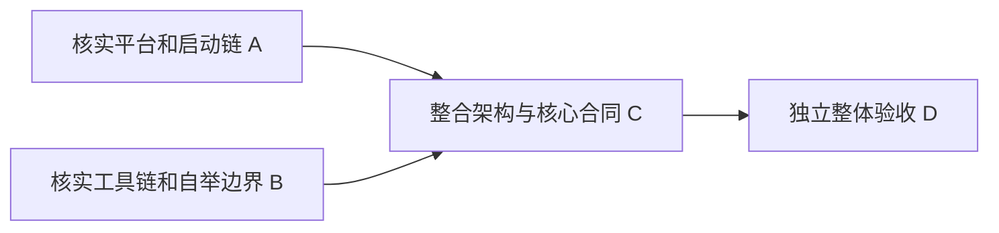

# 全局架构设计交付 DAG

日期：2026-10-13—2026-10-14。范围仅为架构设计、证据调查和实施计划，不启动内核产品实现。
需求输入：`../REQUIREMENTS.md`（2026-10-13）；编译器基线 `biomiya@2c7061c`。

| 节点 | 输入/依赖 | 产物与唯一写入范围 | 实施者 | 独立验收者 | 标准 | 状态 |
|---|---|---|---|---|---|---|
| A | 需求基线、当前环境 | `research/platform.md`、`research/platform-*` | `/root/suba_platform` | `/root` | 固定设备配置、启动/重启路径、规范来源、实查与待验证边界可区分 | 已验收，版本见记录 |
| B | 需求基线、现有 Q 编译器 | `research/toolchain.md`、`research/toolchain-*` | `/root/suba_toolchain` | `/root` | 真实依赖和容量、最小改造、原生汇编与内核重建闭环、证据定位 | 已验收，版本见记录 |
| C | 已验收 A、B 当前版本 | `ARCHITECTURE.md`、`CONTRACTS.md`、`IMPLEMENTATION.md`、`../README.md` | `/root` | `/root/suba_design_review` | 贯通全部需求；部署/状态/等待/故障/成本/构建闭环可追踪；决策与探针分开 | C r3 已独立验收 |
| D | C 与 A、B 的冻结组合 | `reviews/integration-*.md` | `/root/suba_design_review`（只读受验产物） | 该节点是 C 与组合产物的独立验收记录 | 逐项需求追踪，反例审查，确认跨模块合同和实施门槛无阻塞矛盾 | 已通过，组合 C r3 / A r2 / B r1 |

调度检查：依赖均存在且无环；A/B 写入不重叠；最终验收者不得参与 A/B/C 编写；当前最多含主代理 4 个并发槽。A/B 调查期间，主代理可做需求梳理和探索，但 C 的正式候选须等待依赖验收。不将规划通过当作实现通过。

候选按文件 SHA-256 冻结；历次评审保存独立文件。变更后重验实际受影响的节点。工作流状态与评审登记不计入受验设计内容。

## 版本与验收记录

A r2 / B r1 已由 `/root` 独立验收，见 `reviews/research-r1.md` 与 `reviews/research-r2.md`。C r1 已冻结，清单 `candidate-r1.json`；尚无已验收整体架构候选。A/B/C 最终组合还须由未参与编写的 agent 审查。

C r1 独立判定不通过，见 `reviews/integration-r1.md`：快照不可变性和 kill 授权未闭合。旧8文件保存在 `revisions/r1/`，身份仍见 `candidate-r1.json`。C r2 已补齐两项合同，并明确 boot 段首入口及关机内部写回，冻结清单 `candidate-r2.json`；等待同一独立审查者复核。A r2/B r1 未变。

C r2 的快照与授权语义经定向审查未发现阻塞；复核指出 start 实际已经在普通函数之前发射，作者更正为平台合同差异。C r3 又明确 fw_cfg 的16位MMIO需增加单项S0 sh包装。r2原文件保存在 `revisions/r2/`，最终待验清单 `candidate-r3.json`。

## 当前交付状态（2026-10-14）

**A r2、B r1、C r3 及其最终组合均已验收；本轮架构任务完成。** 最终独立验收者 `/root/suba_design_review`，判定见 [integration-r3.md](reviews/integration-r3.md)，受验身份见 [candidate-r3.json](candidate-r3.json)。r1失败及r2复核报告保留，没有用新候选覆盖旧结论。最终检查无未处理的设计阻塞；状态更新不改受验正文。

已完成的是设计与有界调查：本地ramfb协议、固定S-mode入口及同一QEMU进程SRST重入有证据；全系统磁盘装载/原生自举仍未实现。K0–K10仅是下一阶段计划，本轮未改compiler或kernel生产代码，未提交或初始化仓库。
