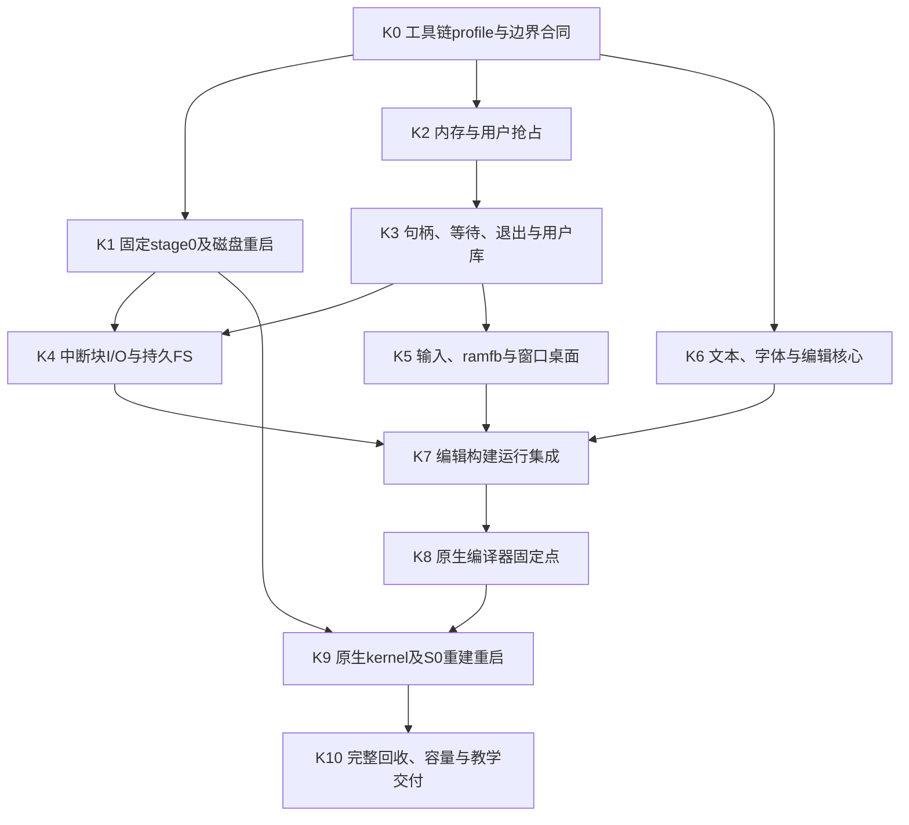

# suba 实施依赖、探针与验收

2026-10-14。本文规划后续执行，**尚未启动下表的产品实现节点**。架构依 [ARCHITECTURE](ARCHITECTURE.md)，接口依 [CONTRACTS](CONTRACTS.md)。调查/本轮设计的已执行记录在 [DELIVERY](DELIVERY.md)。

## 1. 实施原则

先证明工具链和启动闭环中最容易失败的边界，再把同一组机制组合为可交互系统。每阶段交付真实路径与有限负例，不累计彼此不兼容的演示内核。首版整体目标不改成“先做 Linux 兼容层”或“先把解释器塞进旧 SOS”。

每个实现节点有独立 reviewer、冻结候选和证据目录，依赖的最新候选通过后才正式启动。执行前绑定真实 agent 身份；以下 owner 是待派发职责，不是已经工作的代理。共享 ABI/磁盘布局、kernel dispatch 和根构建清单由集成负责人独占写入，下游通过已冻结合同消费。复用同一 agent 可跨节点，但不得自审自己的产物。

## 2. 产品 DAG



| 节点/计划 owner | 有界产物与主要写入范围 | 必须实际观察到的验收 | 失败时停止什么 |
|---|---|---|---|
| K0：工具链/合同负责人 | `biomiya/core-s/next/q` 的平台解耦、四profile、有限桥与S0扩展；`suba/abi`、`suba/platform` 版本清单 | Linux固定点与既有回归；新target段/reloc/入口/桥正反例；机器操作独立编码检查；所有清单容量和实际静态内存统计 | K1/K2正式机器实现不得基于手改ELF、宿主链接胶水启动 |
| K1：启动负责人 | `boot/`、共享`lib/format`、最小`kernel/device/virtio`传输逻辑；正式stage0清单 | 同一QEMU进程：从raw槽启动版本A→guest写B/FLUSH→SRST→从盘运行B；旧槽手选；坏头/坏ELF拒绝；正式S0，无host linker | 整条原生内核闭环；不能用换`-kernel`文件替代 |
| K2：内存/调度负责人 | `kernel/memory`、`space`、`process`、`machine` | 用户死循环可抢占；越界/S-mode指令只杀应用；32寄存器现场、栈guard；多次创建失败回滚；实际ELF BSS清零与权限 | 不在没有保护的单地址空间上扩展正式桌面 |
| K3：资源/用户库负责人 | `kernel/objects`、`request`、`stream`、`user/libsuba` | 有限系统调用、用户跨页范围、stale handle、丢唤醒/超时竞争、父子取消、EOF/背压、统一退出基线 | FS/窗口不得各自另造资源与等待体系 |
| K4：存储负责人 | `kernel/device/block`、`kernel/fs`、`tools/mkfs` | 真正IRQ/FLUSH；create/read/write/delete/replace正常重启保留；写满与节点满回滚；kill时DMA排空；打开旧版本仍可读；损坏盘拒绝 | 编辑器不能宣称“保存成功”，原生构建不能以宿主目录代替 |
| K5：桌面负责人 | `kernel/device/input`、`display`、`window`、`user/desktop`、`user/draw` | guest驱动和GTK实际键鼠；两窗口重叠/移动/焦点/关闭；死循环强杀；表面立即回收；事件溢出恢复键状态 | 不把qtest红图或串口计数当桌面交付 |
| K6：文本负责人 | `user/text`、`user/edit`核心、`tools/fontpack`、`assets` | UTF-8 1–4字节边界；中文显示/修改字节；缺字与非法输入；4MiB上限/内存失败；固定字体覆盖表/许可与原生fontpack输出 | 不声称支持IME/grapheme/补充平面完整字体 |
| K7：集成负责人 | 共享dispatch/清单、editor UI、build、初始盘组织 | 系统内编辑→保存→快照→编译→诊断→运行；编译时另一个窗口响应；取消构建和损坏输出不发布；不借宿主文件服务 | 不进入原生自举完成声明 |
| K8：工具链原生验收负责人 | 系统内compiler自构建记录/测试清单；必要修复回原owner | C0→C1→C2→C3全文件相等；源码行为扰动；Linux/suba同目标输出比较；子进程退出回收 | 不以Linux-user旧固定点替代本机证据 |
| K9：引导/集成负责人 | 原生build与kernel发布、正常关机；stage0重建检查 | 分别修改VT和S0后全原生重建→写槽→重启见新行为→再编译应用；固定宿主命令、无宿主重打包；stage0本机产物对比 | 首版不得宣布完整系统自举 |
| K10：独立整体验收与文档负责人 | `tests/`、成本账、读者路线、版本化系统参考 | 本文§4全部场景；多轮终止基线；实测内存/延迟/规模；清洁复现；原始失败证据与已知边界 | 有必需失败就保持未完成，不改口径通过 |

K1 的最小传输逻辑由它的 owner 定接口；K4 复用并添加中断上层，禁止并行重写同一文件。K2 在 K1 尚未完成时可以使用固定内存测试映像验证进程机制，但这只是 K2 的局部fixture；正式应用装载在 K4/K7 接回同一 FS/ELF路径，不保留第二套生产loader。K6 的编辑算法/字体处理可在Linux用户侧运行，但其图形和保存验收必须到K7在suba完成。

有限并行：K1/K2/K6 可在 K0 后并行；K4/K5 可在 K3 后并行（K4还等K1）；K7 是强制汇合。集成负责人在每次汇合核对合同，不把各组件“通过”直接等同完整系统通过。

## 3. 最先冻结和验证的事项

K0 首先产生 `abi/contract` 的固定记录：BootInfo/TrapFrame/启动参数、syscall号与错误、句柄代数、窗口事件、磁盘头/FS字段偏移。用当前语言能读取的普通文本或VT常量表达，保留一个权威来源；如果使用生成器，生成器自身也用S-next并可系统内构建。不能仅在宿主Python中生成关键汇编偏移，形成新的隐蔽依赖。

新增S0的CSR/fence/sret/wfi和对齐规则，需要机器码对照及非法操作数负例；GNU工具可作独立测试oracle，不能在正式产物流水线修补或重链接。若不用M-mode路径，则不因“完整ISA”增加mret/AMO体系。

K0 不重做语言设计。维持现有核心语义；运行环境模块与target布局是编译器边界。32源文件限制若妨碍合理模块拆分，依据实际清单统一提高至64并验完所有关联表/边界/内存；不为凑32把模块塞成巨型文件。其他容量先统计再改，不默认无限增大。

K1 必须验证真实磁盘链。目前仅有 ramfb qtest 协议、OpenSBI进入S-mode和同进程SRST探针；重启探针用RAM标记，不能证明磁盘持久化。正式镜像槽大小32MiB与kernel最大64MiB内存跨度是两项独立校验。

K2/K3 最危险的是 trap 与内核推进上界：调度必须在每片后获得机会，所有copy/clear/scan/close/reap 都不得在关中断区遍历无限输入。初始每步数据量≤64KiB，表扫描≤64项；实测之后可调。目标是在指定QEMU环境、两个编译任务背景下，交互请求开始处理延迟99%≤100ms、单次S-mode连续工作≤5ms；这是**测量目标**而非实时保证，未达时先找无界循环和多余复制，不直接增大时间片掩盖。

K4 固定 virtio modern transport、一个split block queue、VERSION_1与FLUSH；不协商未实现feature。应用kill与DMA完成的先后顺序、空间预留失败和元数据IO错误是单独案例。设备故障停机与普通应用失败回收分开记录。

K5 冻结固定1024×768/30Hz上限，观测完整合成耗时和像素拷贝量。ramfb前缓冲3MiB在启动时预留连续物理页。全窗拷贝可分片，合成器用户态可被抢占；如果绘制落后，丢弃中间损伤并合并重绘，不能把渲染推入不可抢占内核大循环。

## 4. 跨模块验收矩阵

| 需求场景 | 正向场景 | 必要反例与证据 |
|---|---|---|
| 启动/设备 | 固定正式命令进入桌面，UART只作诊断 | 缺设备/错误feature/错误RAM/错固件受控停机；记录QEMU/固件/源码/产物身份 |
| 多进程隔离 | 两应用分别写私有内存并持续显示计数 | 写内核/其他进程、用户CSR、非法指令、除零panic、死循环；受害应用数据和计数仍正确 |
| 资源回收 | 正常退出/关闭与强杀同一基线 | 至少100轮分别kill装载中、就绪、流等待、磁盘等待、窗口更新后的进程；页/句柄/等待/表面/在途请求回基线，缓存warmup另计 |
| usercopy/身份 | 跨有效页读取/写入 | 地址加法溢出、跨guard、RO目的页、超长记录、错误对象类型、关闭后重用槽/迟到完成；内核不panic |
| 桌面 | 两窗口重叠、焦点、拖动、CloseRequested | 不响应close的应用强杀；快速创建销毁/大量motion/键队列溢出；无焦点残留或stuck key |
| 中文文本 | UTF-8中英混排、选择/删除/保存再打开 | 4字节缺字原字节保留；组合字符按已声明粒度；非法UTF-8拒绝；文件超限不破坏旧文件 |
| 正常持久化 | 保存后sync、正常关机、重启比较全字节 | NoSpace/节点满/temp创建失败/未seal compiler输出；旧文件仍可读、空间无漏；不把拔电测试列为本版门槛 |
| 构建闭环 | 编辑→诊断→改错→编译→运行，另窗响应 | 构建时继续编辑得到快照语义；流满/关闭/取消；失败构建不产生可误认成功的发布产物 |
| 编译器自举 | 原生C0→C1→C2→C3及可观察扰动 | 空宿主工具依赖；检查产物来自本次执行而非旧文件；保存全部清单/完整哈希/差异 |
| 内核自举 | 原生修改VT及S0、发布、复位新行为 | 坏ELF/超槽/源修改竞争/发布前取消；旧槽选择有效；重复构建；观察宿主`-kernel`固定不变 |

每份记录需说明实际执行环境、输入版本、动作、期望、结果和原始日志路径。通过图形验收需要真实输入或QMP输入注入与guest事件、可见帧对应，不只调用绘图函数。存储验收用真正磁盘后备文件与新启动读取；host只负责建初始盘、启动、注入测试输入和观察。

测量资源回收时区分可复用缓存与泄漏：预热到稳定基线，记录每类对象活数、页owner、设备引用；等待有限的排空期限后比较。不能只看某个用户进程已从列表消失。坏设备永不完成的场景应得到已声明故障停机，不能计作“完整回收成功”。

## 5. 目录、读者路线与成果边界

计划目录（不是现有实现）：

```text
suba/
  abi/                 外部记录、偏移与版本的唯一来源
  boot/                固定stage0与suba-boot清单
  kernel/              machine、memory、space、process、request、fs、device、window
  user/libsuba/        系统调用包装、文件/进程/事件的具体结果类型
  user/text/ draw/     UTF-8、字体、裁剪和绘制
  user/desktop/ edit/  窗口策略与开发环境
  tools/               build、fontpack、镜像初始化/校验；目标工具与host脚本分开
  assets/              字体源、许可、固定资源
  tests/               单模块反例、QEMU端到端、故障/回收和自举记录
  docs/                面向使用者的版本参考、读者路径、实测成本
  design/              本架构与决策证据
```

不复制另一个compiler维护树到suba；源码仍由 `biomiya/core-s/next/q` 维护，初始磁盘和本机构建快照包含明确版本的源码副本。`SOS/` 不参与构建或需求。当前工作区根/suba 尚非Git仓库，biomiya是独立Git仓库；本轮不擅自搬迁、初始化嵌套仓库或提交。正式实现前保持跨目录变更清单和各自产物版本，不能只提交biomiya便声称suba已被版本化。

教学说明按三条路径组织：`spawn→ELF→页表→首次sret`、`read→Wait→IRQ→copyout→恢复`、`fault/kill→令牌失效→资源释放→退出记录`。最后接上`edit→compiler→发布→reboot`。每条路径给真实源码入口和状态变迁，避免按目录逐文件讲解却看不到系统行为。

规模与性能到K10给实测结果，当前不预测行数或交付天数。需要扩展语言、设备组合、地址模型或运行时并发方式时先返回对应合同说明影响，再修改依赖；不能默默把未验证的实现选择变成新需求。
