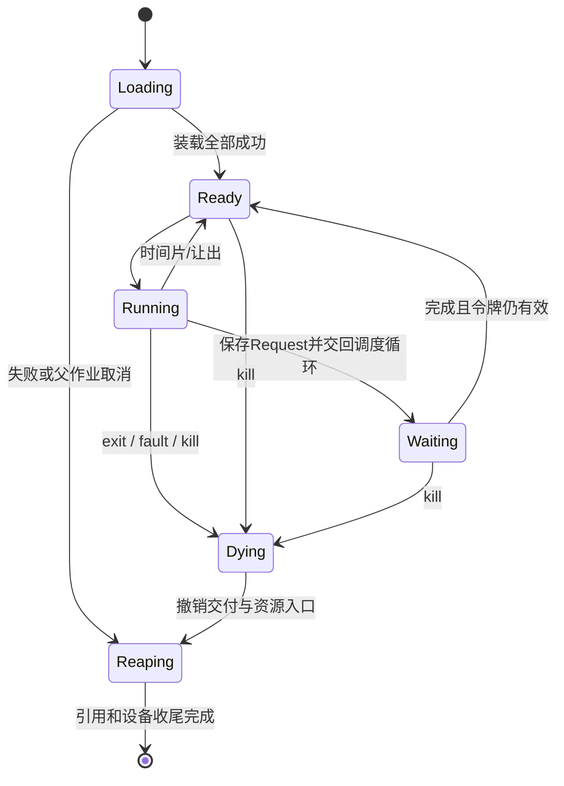

# suba 核心接口与生命周期合同

2026-10-14，设计版本 0.1；配套 [全局架构](ARCHITECTURE.md)。以下是首版设计决定，不是已实现 API。机器记录和系统调用记录采用显式偏移与固定小端编解码；不得把 S-next 聚合内存布局直接当作外部协议。实施 K0 要冻结机器可读布局清单及双向探针，数值变化须提升 ABI/磁盘格式版本。

## 1. 地址、入口与现场

| 范围/项 | 首版合同 |
|---|---|
| 物理 RAM | `[0x80000000, 0xa0000000)`，启动核实 DTB；页 4096 B |
| 固件保留 | `[0x80000000, 0x80200000)`，尊重固件 PMP 和 DTB reserved-memory，不读取不可访问区 |
| stage0 保留 | `[0x80200000, 0x80400000)`，含程序、BootInfo、复制后的 DTB、加载缓冲和引导栈；不向普通页池释放 |
| kernel ELF 允许窗口 | `[0x80400000, 0x84400000)`，最大 64 MiB 地址跨度；实际装载结束后再分配物理页，窗口未占用部分不是永久浪费 |
| kernel 虚拟地址 | S-only 的物理恒等映射；固件禁止区域不映射，内核 text RX、rodata R、data/页池 RW+NX；MMIO 单独映射 |
| 用户 ELF | 从 `0x10000` 开始，跨度≤64 MiB；RX/R/RW 分离；BSS 清零，无 RWX |
| 用户动态页 | `[0x08000000, 0x18000000)`，显式页分配/释放；无 swap/COW/按需缺页 |
| desktop 专用映射 | 从 `0x20000000` 开始的 3 MiB ramfb 映射 RW，无执行权；窗口表面不直接映射到 desktop |
| 参数/栈 | 参数页 `0x3fe00000`，RO；用户栈 `[0x3ff00000,0x40000000)`，1 MiB RW+NX；下面至少一个未映射 guard 页 |
| usercopy 边界 | 不接受内核区、MMIO、未映射区或越权页；SUM 常态为 0 |

启动时先登记 DTB 实际存放范围与所有 reserved-memory，复制必需 DTB 到 stage0 保留区，方可复用原 DTB 页。stage0 的文件跨度和 BSS 必须留出足够栈/缓冲/DTB 空间；若超过 2 MiB 保留区，报容量错误，不能覆盖内核。固定 firmware 文件与 QEMU 二进制哈希在 K0 环境清单中固化。

SBI 把 hart id 放 a0、DTB 放 a1 进入 stage0 的机器入口。stage0 清 BSS、设 16 B 对齐栈，再进入 S-next；它把序列化 `BootInfo` 的物理地址放 a0 跳 kernel 机器入口。BootInfo 包含 magic/abi/length、RAM范围、DTB地址长度、保留区域列表、选中槽/内核校验值；数量与总长有上限。kernel 验证后建立自身页表和栈，不保存指向可复用引导缓冲的引用。

四个固定 profile 的布局在编译器内以有限记录选择：linux-user/suba-user 取低地址，suba-boot 取 0x80200000，suba-kernel 取 0x80400000。符号修补、静态重定位、ELF段、entry 检查都读取这份记录。内核与 boot 的 ELF 不能含多余低地址 PT_LOAD；已有平台探针证明仅改 text 地址会选错启动地址。

`suba-boot` 另有硬约束：**最低 PT_LOAD 的第一个字节就是机器入口stub，地址与 e_entry 同为 0x80200000**。当前 Linux 生成器在函数之后追加 start 的顺序不能直接沿用；boot profile 必须先发射固定入口stub，再生成普通函数和后续桥接修补，且所有代码仍在其限定窗口内。kernel 则由自有stage0读取经验证的 e_entry 进入，不假设它一定等于段首。K0 对“正确e_entry但错误最低段/段首”的负例必须拒绝。

固定桥的逻辑合同：`boot_entry(hart:usize,dtb:usize)->u32`、`kernel_entry(info:usize)->u32`、`trap_dispatch(frame:usize)->usize`（返回待恢复现场的地址），以及各 profile 的终止/panic 终点。启动函数返回即视为系统错误。名字由清单中的有限 bind 项指定，编译器校验签名和唯一性并生成内部 ABI 胶水；不提供任意 export 或函数地址值。应用正常入口仍是无参数 `->u32`。

TrapFrame 固定保存 x1–x31（包括用户 sp/x27）、sepc、sstatus、scause、stval；x0 不保存。计划字段全部 8 B，前 31 项对应 x1–x31，其后依次四项，总 280 B，分配向 16 B 对齐为 288 B。进入时保存现场后才使用寄存器；恢复 sstatus 只取批准字段，不让用户提供 SPP/SUM/SIE。调度器选择的进程和地址空间必须匹配 frame owner。ASID 首版统一 0，切换 satp 后 sfence.vma；首次执行新装载代码前 fence.i。

x27 在 suba-user 中是只读启动参数块指针，跨普通调用、extern 和 trap 保持；Linux profile 继续是原来的初始栈约定。FP/vector 状态首版不保存，用户 FS/VS 置 Off，使用相关指令终止该应用。kernel 禁止递归 trap：共享内核栈计划 128 KiB，加 guard 与独立 panic 栈；S-mode 意外异常走紧急停机入口，不能按用户异常回收当前进程。

## 2. 系统调用和句柄

用户 ecall 使用 a7 选择固定调用、a0–a5 传标量或用户记录地址。返回 a0=状态、a1=值；0 表示成功，其余为本系统自己的错误枚举，绝不借用 Linux 负 errno。错误包括 Invalid、BadHandle、Denied、NotFound、Exists、Busy、NoMemory、NoSpace、Limit、WouldBlock、Io、Unsupported、Cancelled、BrokenStream。关闭是否落盘由单独合同决定，不混为一个成功状态。

以下是必须提供的**语义集合**。K0 在 `abi` 唯一清单中分配调用号和记录偏移，并生成/校验两侧常量；此处不把尚未编译验证的函数签名冒充语言参考。

| 调用族 | 必需操作及边界 |
|---|---|
| Process | spawn（路径、argv、cwd、显式继承的流）、exit、kill_child、collect_exit；创建Job、冻结输入/结束作业；不能 fork 或注入特权 |
| Memory | alloc_pages/free_pages，返回属于调用者的固定区域；范围与配额检查、失败回滚 |
| File | open/read_at/write_at/stat/close/sync；offset 为显式参数；单次数据≤64 KiB |
| Namespace | mkdir/list/unlink/replace；路径≤255 B，UTF-8名字≤63 B，深度≤16，无软硬链接 |
| Stream | 创建读写端、读/写、关闭；64 KiB 环缓冲，支持阻塞或 WouldBlock |
| Event | try_read、wait；一次等待≤16 个已持有对象或进程事件，附可选绝对截止时刻 |
| Window | create/update_rect/destroy/try_event，max 4/进程；坐标、stride、字节范围逐项检查 |
| Desktop | 列表/只读拷贝表面、提交布局/焦点、路由键鼠、关闭/强杀请求；需启动时授予的专用权 |
| System | 请求发布、sync_all、正常关机/重启、只读统计；发布和电源操作需专用权 |

每个系统调用都可以受控失败。输入记录先有界复制到内核，校验版本、长度、枚举和范围，再访问字段；整数 checked 运算可能 panic，因此所有不可信加法先用减法边界/溢出检查。path 不做宿主路径映射；OS 支持绝对路径和相对 cwd 的路径，编译器 manifest 仍只接受既有相对路径子集。

Handle 为进程私有 64-bit token：槽索引及代数。内核同时检查进程身份、槽代数、对象类型与 rights。对象身份也含代数；复用不能使旧等待/完成事件命中新对象。代数耗尽时退役该槽，不回绕碰撞。对象表是有限 `File/Stream/Window/Child/Job` 枚举和各自所有者，不开放用户定义种类。

spawn 不隐式继承父进程全部句柄或管理权。默认继承工作目录身份、普通文件工作区权限及显式 stdout/stderr 流；完整 argv 限一页。创建子进程前预留进程槽、内存和退出记录，加载失败全部撤回。父进程对孩子持有 Job/Child 对象；父退出默认终止其作业树。desktop 作为常驻根启动应用；不提供普通应用 daemonize。

普通终止只允许 self-exit，或消费自身句柄表中带 Kill 权的 Child/Job 句柄，范围限于自己创建的子作业树。collect_exit/取消子树同样要求对应 Child/Job 权；句柄不提供向无关进程转移的接口。裸PID、窗口ID、路径名都不构成终止权；PID复用仍须匹配对象代数。desktop 的单独 ManageApps 权允许终止其他普通应用，但不能终止自身、可信系统进程或内核；可信程序故障由内核停机。普通进程不能通过kill触发此系统故障路径。

管理权只在 kernel 启动时授予固定加载的 desktop/系统发布入口；普通 spawn 不能指定 privileged=true。系统发布入口可作为 desktop 的受控管理动作：用户在 build 面板选择已完成 kernel 文件，desktop 提交只读文件句柄，内核执行发布。build 程序不获得原始块写能力。

初始命名空间分为 `/sys`（启动所需桌面/资源/种子工具，普通应用只读）、`/work`（源码、已发布构建产物，普通应用可写）与 `/jobs`（内核管理的临时作业树）。进程不能通过相对路径或节点句柄越过授予的根及权限。kernel 仅对初始化时加载的指定 desktop 授权，随后从 `/work` 运行一个同名 ELF 仍是普通进程；不能把可任意替换的文件路径当作授权凭证。编译器后继产物在 `/work` 运行，不需要改变 `/sys`。首版 `/sys` 更新属于可信系统发布操作，普通文件 replace 无此权限。

## 3. 进程、请求与退出

每进程最多一个在途系统调用。Request 为具体变体，如 LoadImage、FileRead、FileWrite、WaitEvents、StreamRead、StreamWrite、Reap；每种仅保存下一步所需字段，不能保存 C/VT 栈、闭包或跨调用裸指针。`UserRange={process_generation,request_token,address,length,direction}` 中 address 是未经解引用的整数。每次实际复制重新页查验；单线程处于 Waiting 时不能自行修改映射，kill 会先使令牌失效。

事件等待的“检查可读→登记→置 Waiting”在同一内核串行临界段完成。完成方先写结果/可读状态再置 Ready，消除丢唤醒。超时、完成和 kill 同样由唯一调度循环裁决；第一项终结令牌，后来的完成只回收它自己的资源，不能再次返回用户。等待多个对象时退出删除全部登记。

**设备持有期不等于应用持有期。**DMA 只使用内核自有、已计账的 bounce/队列页。kill 不回收已提交 DMA buffer；取消只是撤销向应用交付的资格。在设备完成或已确认 reset 后才释放设备引用。首版设备超时停机，不声称可在失去设备响应时完成所有回收。

统一退出顺序：

1. 标记 Dying，从就绪/等待结构移除，撤销所有 request token，拒绝新调用和窗口更新。
2. 清除焦点/输入关联，标记窗口 Dead、递增代数并回收表面页。desktop 只持有已经拷贝到自己地址空间的像素，下一次读取失效身份返回 BadHandle，不会访问已释放页。
3. 关闭句柄、减少节点/流引用，终止子作业。流写端消失读者得到 EOF；最后读端消失写者得到 BrokenStream，不永远等待。
4. 取消未提交请求；已提交 FS/块事务由系统收尾。未公开的临时文件按所有者清理规则删除；已完成的正常文件写入不因为进程终止自动撤销。
5. 释放普通地址空间和页表，保留必要的内核请求/设备引用；原用户页绝不作为 DMA 缓冲，因此不需等待它们才能释放用户页。
6. 待剩余系统引用清零，释放进程槽/计账尾项，把固定大小 ExitRecord 交给父作业。退出记录由父消费或父退出释放，不保留整个 zombie 地址空间。

重复 kill/close 和迟到 IRQ 不得二次释放；失效 token 返回 BadHandle 或忽略内部已撤销完成。分配失败走同样对象释放操作，避免每个错误路径手写一套回收。

## 4. 等待中的文件读：一条完整路径

应用调用 read_at → 内核验证 File rights、offset/len 和 UserRange → 建立≤64 KiB staging 请求 → 缓存命中则复制并返回；不命中则 FS 决定物理块，block 提交内核 DMA，进程 Waiting → 调度其他进程 → PLIC/virtio 完成 → block 验证 used id/长度/状态后移交缓存 → FS step 组装本次结果 → request 检查 process generation/token → 逐页重新验证 copyout → a0/a1 填入原 trap frame → Ready。

若在任一点 kill：不再 copyout；已经发出的 DMA 排空，文件/缓存引用由收尾动作释放。若用户目的页不合法，返回 Invalid；不能因内核解引用坏指针而 panic。大文件库函数重复调用有界 read_at；offset 只在实际成功字节数后增加。

串行 FS worker 每次只推进一个有限工作片，等待磁盘时让出 CPU。一个元数据操作的逻辑锁可以跨 I/O 保持，但不会禁止进程调度或输入 IRQ；其他 FS 请求排队。不使用全局关中断忙等来模拟同步文件 API。

## 5. 磁盘格式、文件一致性与写满

全盘 256 MiB=65,536 个 4 KiB 块=524,288 个 512 B 扇区。所有磁盘数值为小端；换算采用 checked 范围，不接受设备宣称范围以外的访问。

| 区域 | 字节区间 | 用途 |
|---|---|---|
| 启动元数据 | `[0,1 MiB)` | 4 KiB 启动头，其余保留，不属于 FS |
| Kernel A | `[1,33 MiB)` | 最多 32 MiB ELF 文件 |
| Kernel B | `[33,65 MiB)` | 最多 32 MiB ELF 文件 |
| FS | `[65,256 MiB)` | 191 MiB，自身 superblock/FAT/节点表/数据 |

启动头含 magic/version、活动槽、各槽文件长度、CRC32、有效标记；槽起点/上限固定于版本而非信任磁盘任意提供的 LBA。CRC 用于偶发损坏检测，不是安全签名。stage0 必须先验完整头、槽文件及全部 PT_LOAD 范围，再写目的内存；入口在 RX 段中、filesz≤memsz、段不重叠，拒绝固件/stage0/DTB覆盖及 wraparound。只加载当前编译器固定 ELF 子集，不解释解释器、动态链接或任意重定位。

FS 以分区相对块号编码：superblock 1块；FAT预留64块（u32×65,536，未用项标 Reserved）；4096×128 B 节点表占128块；余下为数据块。节点包括类型、generation、parent id、UTF-8 name、size、first/last block 与必要标志；root 固定。0/Free、EOC、Reserved 有不同编码；遍历步数不得超过分区数据块数，检测环、重复所有权和指向元数据的链。挂载时校验一次完整分配关系；坏盘报故障，不自动“修复”后继续声称内容正确。

普通文件≤16 MiB，因此首版从文件发布的kernel文件仍受16 MiB上限约束，32 MiB启动槽不是可放宽它的接口；64 MiB ELF内存跨度独立计算。目录为空才可删除；首版不支持目录 rename。名字替换仅用于同一目录的普通文件，以唯一 FS 所有者更新可见节点关系。open-read 可共享，open-write 独占且与该节点所有读者互斥。已写文件的 `write_at` 不越过 EOF 留洞，不做 sparse file；追加分配先预留节点/块，再拷贝/写出，再发布长度。NoSpace/Limit 在提交前返回，预留可完全撤销；流式库的先前成功写入仍然有效。

文件内容缓存固定最多 4 MiB；FAT与节点元数据常驻且单独计账。每个写/删除/replace 请求保存有限的推进游标，禁止把16MiB文件或完整删除链复制到kernel栈。磁盘操作一次传输≤64KiB；FS元数据修改串行，无多写者锁系统。

`write_at` 成功只表示该段被系统接受，`close` 只释放引用，均不等于断电持久化。`sync(file)` 完成数据和相关元数据写回、设备 FLUSH 后成功。编辑保存采用：创建 owner-tagged 临时节点 → 写全 → sync(temp) → replace(temp,name) → sync(namespace) → 显示保存成功。replace 对运行中的读者原子可见；正常流程最后释放旧节点引用并回收空间。跨掉电不保证原子。

临时节点有明确创建者和发布状态，不靠文件名猜测：普通 create-new 可以选择 Transient；compiler 输出适配使用它，成功完成后显式 seal。进程退出删除其尚未 seal/publish 的临时节点，包括部分 compiler 输出。已 seal 的普通文件保留。构建快照目录由父 Job 拥有，作业结束后删除未需保留的快照/临时产物；全链路目录清理同样分片推进。

正常分配不足是请求错误，必须回滚预留。实际设备 I/O 错误/超时可能使磁盘状态无法确认：停止新的 FS 修改、标记保存/发布失败，进入明确的存储故障停机路径；不假装回滚磁盘上已发生的部分写入，也不允许成功关机提示。这里不扩张为日志恢复系统，属于需求允许的可信平台故障边界。

## 6. 窗口、队列和迟到事件

Window 对象含 owner、generation、尺寸、表面页、布局/焦点版本与输入队列。表面物理页由 memory 分配、window 持有、owner 计账。普通应用只有 update_rect 权：内核验证矩形不越界、stride/乘法不溢出、总量≤64KiB，然后经 usercopy 写表面。应用从未获得其他应用或 compositor 的可写页面。

desktop 通过 `copy_surface(window,generation,rect,destination)` 取得最多64KiB像素快照，内核校验管理权限和身份后在同一个有界步骤完成copyout。desktop 不持有窗口页的直接映射，也不把应用地址当图像。应用退出后表面可以立即回收；尚未绘制的本地拷贝只会显示一个过时画面，下一次窗口列表/代数检查会使它失效。无跨进程借用握手或等待 compositor 归还页的协议。

这是有意支付一次像素拷贝以简化生命周期。首版先测量实际合成耗时；只有量化证明此拷贝成为瓶颈，才讨论带严格借用期的共享映射，不提前引入它。大窗口分块读取，帧内可能混合应用的不同更新版本，允许视觉撕裂但不允许悬挂引用。

输入设备队列归内核永久所有；应用从不负责回补 DMA。keyboard/tablet 的原始状态先进入 desktop，再由受权路由按焦点版本送至窗口。移动/损伤事件可合并；键/按钮边缘满队列时设置 InputReset，清空该窗口的按键状态并报告溢出，避免永久“按住”状态。WindowDead、ChildExit、CloseRequested 使用状态位/专用保留槽，不得因普通事件刷满而丢失。wait 依据状态可读性，不只依据某次通知是否到达。

desktop 在一个有界渲染步骤中读取像素快照并绘制到自己的后缓冲，最终拷贝损伤到ramfb。应用可在帧间更新表面；首版不保证采样同一内容版本，允许视觉撕裂，绝不允许读已释放页。应用大量更新仅合并损伤，不让其创建无界队列。初始刷新上限30Hz，空闲时等待事件/下一截止时刻。

坐标使用非负屏幕空间；窗口拖动保持标题栏在屏内，裁剪采用先比较后相减。相对滚轮等有符号设备值在边界解析为方向和幅度，避免在仅有无符号类型的语言中错误下溢。

## 7. 编译作业到重启：完整合同

edit 先同步保存所有参与源文件，再创建由父 Job 持有的 `/jobs/<id>/`：`src/` 为准备中的输入树，`out/` 为输出区。准备期间只有带 Prepare 权的作业所有者能修改该树，不能把公开的 `/work` 可写权限套在 `/jobs` 上。编译器未启动，其他普通进程不能改名字或内容。

采集一致性采用有限版本核验：FS owner 提供 `(boot_id,source_epoch)`，仅在非 `/jobs` 修改的逻辑提交边界读取；`/sys`、`/work` 的每次内容/名字变化都递增 epoch，`/jobs` 的准备写入不递增它。epoch 不回绕。build 先取版本，逐个打开/复制清单、VT、S0与Blocking策略，关闭输入读句柄；复制期间可以接受继续编辑，但保存可能使该轮采集失效。`freeze_inputs(job,expected_epoch)` 在FS串行点比较版本，变化则拒绝并清理本轮作业、报 Busy（有限重试，不无限等待）；相同才把整棵src树设为Frozen。没有长时间持有64+8个源句柄的需求。

Frozen 是内核强制的树权限，不是普通文件的seal标记：禁止文件写入、截断、替换、删除、改名、新增条目和移走祖先目录。冻结动作撤销该树已有的写句柄权限；每次实际write及排队请求推进仍复查树状态。冻结前必须排空该树已接受的修改，没有在途写才可成功。所有者也不能解除冻结，只有作业结束后的内核清理可删除。输出区独立，作业只授予选定compiler子进程写out的权限；子进程只能读src。作业结束/取消先终止子树、排空请求，再以内核权限回收整棵临时树。

清单副本位于 `src/program.build`，其source/assembly相对路径在原相对路径前加 `src/`，output改为 `out/result.elf`；compiler cwd为作业根，CLI策略路径也加src前缀。保留源内部的相对层次，诊断记录同时保存原路径与快照路径映射。加前缀后的96B路径与16KiB清单容量先检查，超限明确失败；不偷偷允许绝对路径或`..`。清单副本、原清单、策略及全部编译输入和内容哈希一并冻结，不能只有VT只读。`src`目录的文件seal只管理保存/退出生命周期，不能代替Frozen权限。

快照成功后 spawn compiler，给予cwd/argv和stdout/stderr写端 → editor事件循环读取两个流，输出到有上限日志（初设1MiB，截断旧内容有提示）→ 父Job取得ExitRecord → 成功时核验已seal的输出ELF，复制/发布到 `/work` 的持久路径，再运行普通应用或请求内核发布。持久产物复制也用临时文件+sync/replace，成功后才释放作业；需要保留的构建记录随产物一起保存。

流满会阻塞compiler，不能阻塞整个桌面。父读端关闭后compiler得BrokenStream并结束；取消作业kill整棵子进程树，临时输出和快照最终回收。构建期间继续编辑只影响 `/work`，已经冻结的src不会改变；新保存进入下一次作业。NoSpace或Busy不能留下无人负责的冻结树。

发布内核是有限状态机：Validate → WriteInactiveSlot → ReadBackCRC → FlushSlot → WriteBootHeader → FlushHeader → Published。发布持有源文件只读引用，不接受可变源或任意原始 LBA。进程取消发生在选择记录提交之前则中止并保持旧槽选择；一旦进入 WriteBootHeader，后续正常写回由内核完成，不再接受取消造成半个正常流程。磁盘失败按存储故障处理。新槽超限/坏ELF在写盘前拒绝。

正常 reboot：拒绝新用户写请求/新spawn（已接受事务、内核临时清理、发布头收尾和sync写回仍可推进）→ 通知并结束普通作业 → 排空取消请求 → sync_all/FLUSH → SBI SRST。只读/显示仍可显示关机进度；不等待应用自愿退出。失败必须保留可观察错误。新启动不依赖 RAM 残留；BootInfo 和启动代数均重建。

原生编译器自举须 C0→C1→C2→C3 完整文件相等，并修改可观察行为证明源码参与。kernel 自举须分别修改 VT 行为与 S0 机器包装行为，重建、发布、在同一固定启动链重新运行，并再次编译普通应用。stage0 的本机构建一致性另验，固定外部 OpenSBI 不宣称由 S-next 编译。
